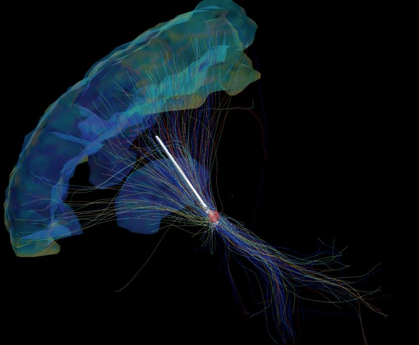
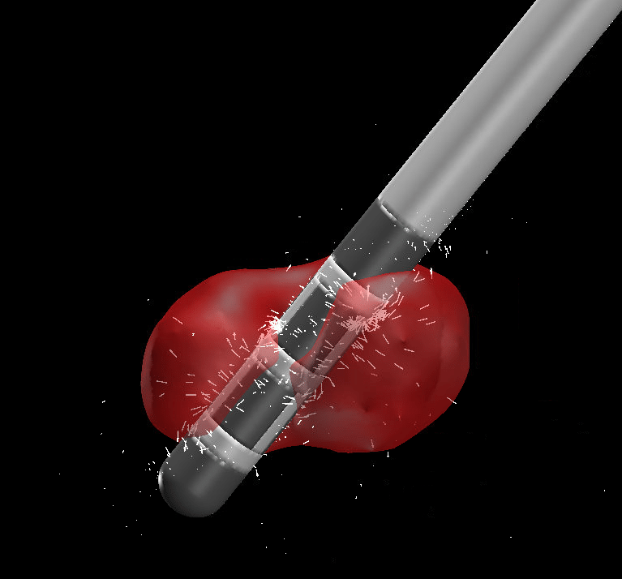

[Till Dembek](https://www.researchgate.net/profile/Till_Dembek) created a segmented Lead Mesh that allows
us to run our FEM-calculations (see [Connectivity Predicts deep brain stimulation outcome in Parkinson disease](https://www.researchgate.net/publication/317381045_Connectivity_Predicts_deep_brain_stimulation_outcome_in_Parkinson_disease);
model implemented based on SimBio with great help from [Johannes Vorwerk](https://www.researchgate.net/profile/Johannes_Vorwerk))
to create VTAs for these electrodes.

{}
{}

{}
{}

{}
{}
