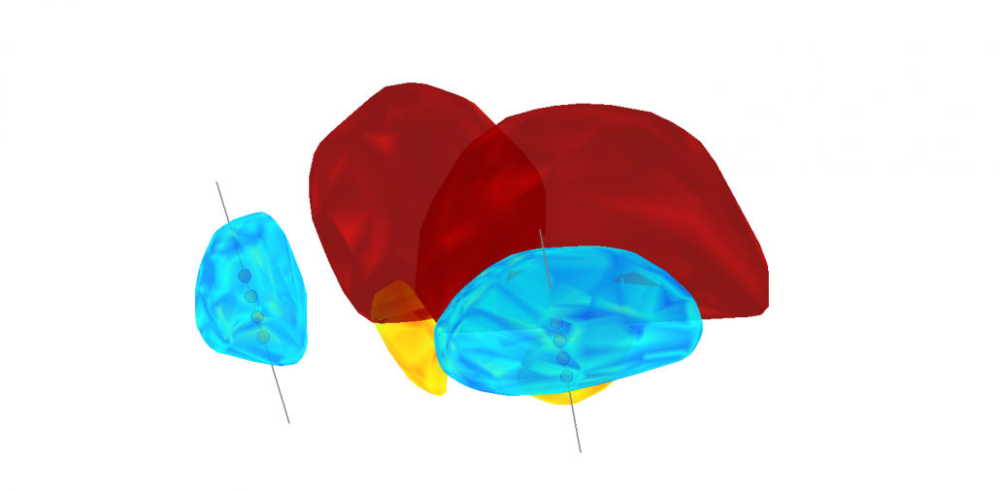
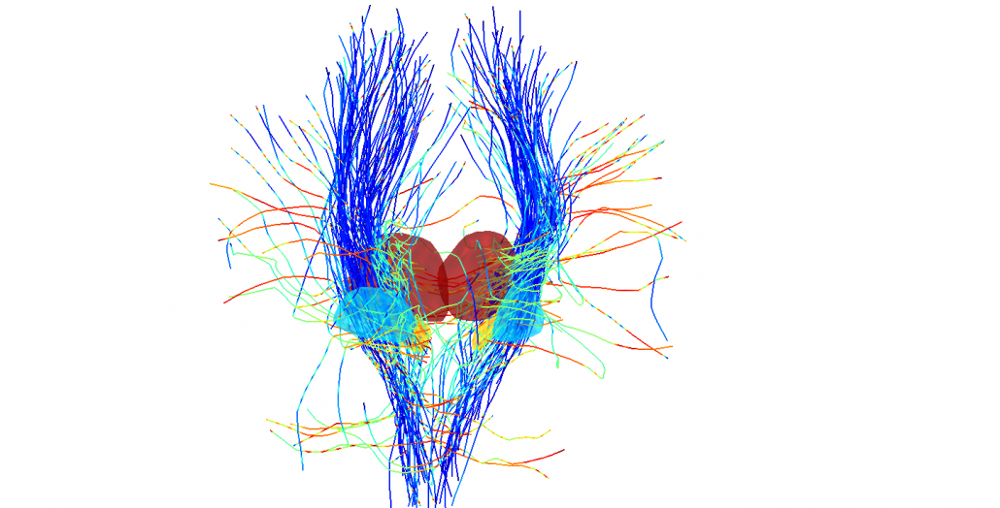
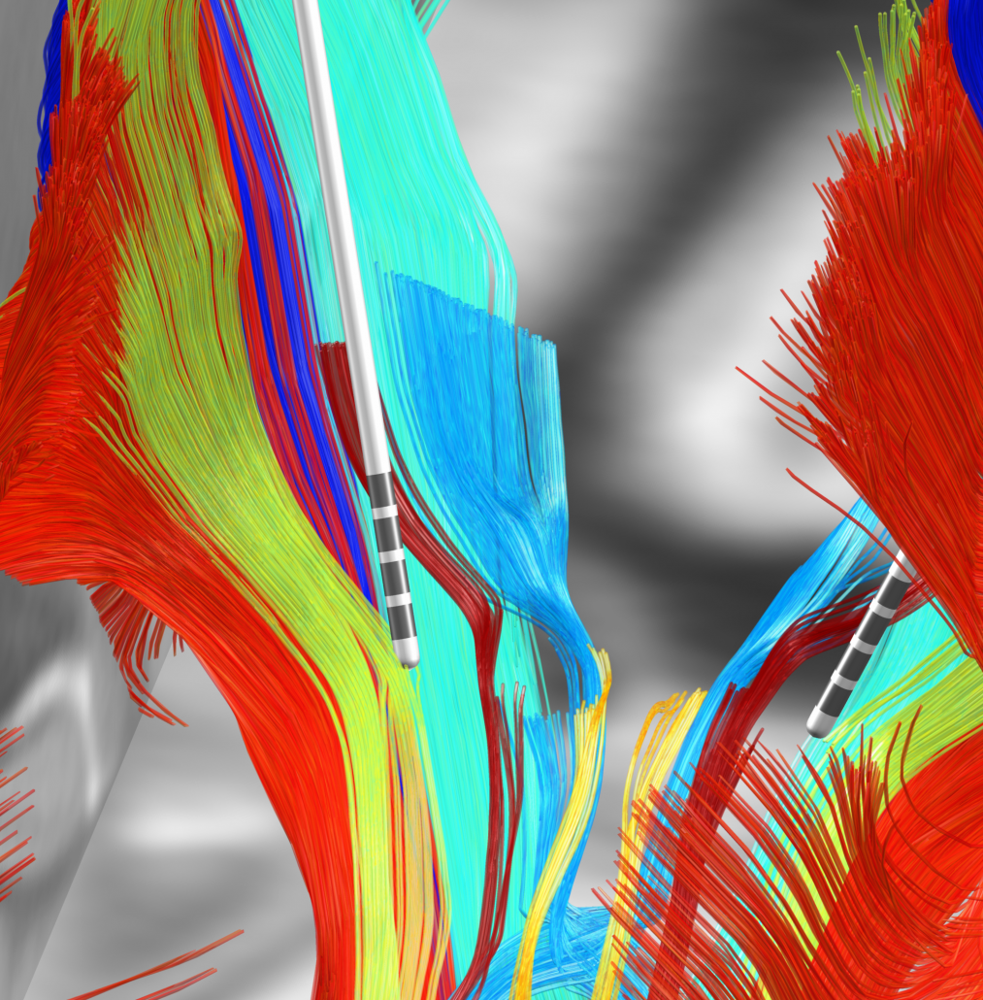

We are applying for funding **to support further development of Lead-DBS** and **need your help**!

In case you like Lead-DBS, it could help you in your research or you simply approve of the general idea of it, please consider taking a few minutes to send us your Letter of Support.

> [A template can be downloaded here](http://www.lead-dbs.org/docs/los/Lead-DBS_user_letter_sample.doc). Please feel free to modify and adjust.

For **Junior Scientists**: Needless to say, we’d love to receive your letter, too! However, it could potentially have even more impact if your PI would be willing to sign it. Thank you so much for considering this.

> Please send your letter of support to *horn [at] neuromodulation [dot] berlin*

Thank you so much for your help and for supporting open source software in DBS imaging!

{}
{}
  
  

*Very early figures made with Lead-DBS (~2012)*

{}
{}
  

*Figure made with a more recent version of Lead-DBS (~2016)*

{}
{}
